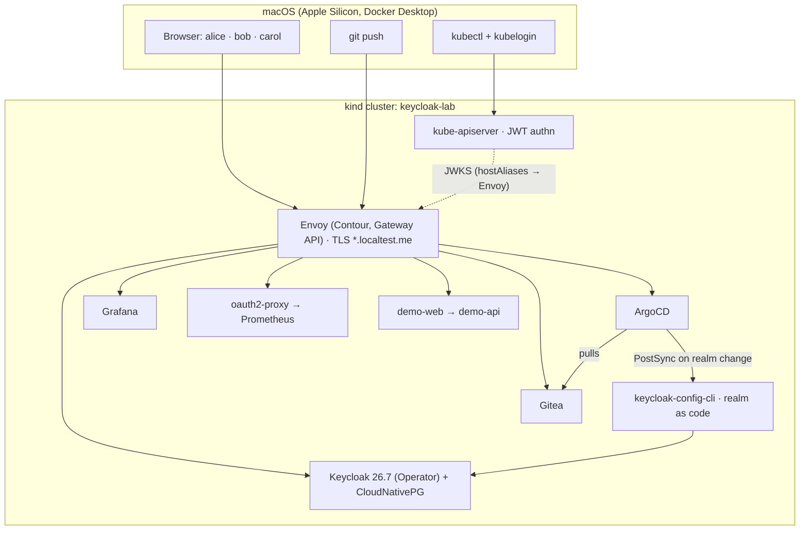

# keycloak-gitops-lab

**Keycloak SSO for a whole platform, delivered entirely by GitOps, on a laptop.**

A reproducible lab that runs Keycloak 26.7 on a local kind cluster and wires it into everything a platform team uses: ArgoCD, Grafana, Prometheus, the Kubernetes API server (kubectl) and a purpose-built demo application. All of it, including the Keycloak realm, ships from Git through ArgoCD. Seven scripts take you from an empty Mac to twelve working identity demos in about 20 minutes.


## What it demonstrates

| # | Scenario | What you see |
| --- | --- | --- |
| 1 | ArgoCD SSO + group RBAC | One Keycloak group decides admin, developer or read-only in ArgoCD |
| 2 | Grafana role mapping | Admin / Editor / Viewer from groups; the limits of single logout |
| 3 | kubectl via OIDC | The API server trusts Keycloak directly (structured authentication config); RBAC on `oidc:` groups |
| 4 | Protecting a UI with no auth | Prometheus behind oauth2-proxy, gated by group |
| 5 | MFA by Git commit | One line in the realm file forces OTP enrolment |
| 6 | Leaver / time to lockout | What disabling a user cuts off immediately, and what survives until tokens expire |
| 7 | Config drift | Admin-console edits persist until the next sync, and how to close that gap |
| 8 | Token anatomy | ID vs access vs refresh tokens, audiences, groups, roles, RP-initiated logout |
| 9 | API authorisation | One API, three users, three outcomes: client roles in action |
| 10 | Role change by commit | Tokens are snapshots: new roles appear only after refresh |
| 11 | Machine-to-machine | Client-credentials service account calling the same API |
| 12 | Revocation | Offline JWT validation vs token introspection, side by side |

## Architecture



Everything after a three-step bootstrap (Sealed Secrets, Gitea, ArgoCD) is an ArgoCD Application in an app-of-apps, ordered by sync waves. Secrets are SealedSecrets in Git. A private lab CA gives real TLS everywhere, trusted by your Mac, the pods and the API server.

## Stack

| Component | Version |
| --- | --- |
| kind / Kubernetes | node v1.34.0 |
| ArgoCD | chart 9.7.1 (v3.4.4) |
| Keycloak + Operator | 26.7.0 |
| CloudNativePG | chart 0.29.1 (PostgreSQL 18) |
| keycloak-config-cli | latest (v6.5.1 at time of writing) |
| Contour / Envoy | 1.33.7 / 1.38.4 |
| cert-manager | v1.21.2 |
| Sealed Secrets | chart 2.20.0 |
| kube-prometheus-stack | chart 92.3.0 |
| oauth2-proxy | chart 10.7.1 |
| Demo app | Python: Flask + Authlib (client), Flask + PyJWT (API) |

## Prerequisites

- **Mac:** Apple Silicon, with Docker Desktop allocated 6 CPUs and 12 GB. Turn Docker Desktop's built-in Kubernetes off, and make sure nothing else is listening on host ports 80/443.
- **Tools:**

  ```bash
  brew install kind helm kubectl argocd kubeseal int128/kubelogin/kubelogin jq yq openssl
  ```

  If Microsoft's `kubelogin` (Azure) is already installed, get the OIDC plugin from krew instead: `brew install krew && kubectl krew install oidc-login`.
- **sudo access:** needed once, to trust the lab CA in the System keychain.

## Quick start

```bash
git clone https://github.com/simonjday/keycloak-gitops-lab.git
cd keycloak-gitops-lab
setopt interactive_comments                      # zsh: allow pasted commands with trailing comments

./bootstrap/scripts/00-lab-ca.sh                 # lab CA, trusted on your Mac
./bootstrap/scripts/01-cluster.sh                # kind cluster with OIDC-enabled API server
./bootstrap/scripts/05-build-demo-app.sh         # build + load the demo app image
./bootstrap/scripts/02-bootstrap.sh              # Sealed Secrets, Gitea, ArgoCD, root app-of-apps
./bootstrap/scripts/03-secrets.sh                # generate, seal and push all secrets
./bootstrap/scripts/06-post-bootstrap.sh         # waits for every wave, enables ArgoCD SSO (10-15 min)
./bootstrap/scripts/04-kubeconfig-users.sh       # kubectl contexts for alice, bob, carol
```

When `06-post-bootstrap.sh` prints its table, every app is Synced and Healthy. Logins:

| Where | User | Password |
| --- | --- | --- |
| Demo users: ArgoCD, Grafana, Prometheus, demo app, kubectl | `alice` (admin), `bob` (developer), `carol` (auditor) | `DEMO_USER_PASSWORD` in `~/.kc-lab-ca/secrets.env` |
| Keycloak admin: https://keycloak.localtest.me/admin | `admin` | `KEYCLOAK_ADMIN_PASSWORD` |

| URL | What |
| --- | --- |
| https://argocd.localtest.me | ArgoCD (Log in via Keycloak) |
| https://grafana.localtest.me | Grafana (Sign in with Keycloak) |
| https://prometheus.localtest.me | Prometheus behind oauth2-proxy |
| https://demo.localtest.me | Demo web app |
| https://api.localtest.me/api/public | Demo API |
| https://gitea.localtest.me | In-cluster Git (user `lab`) |

`*.localtest.me` resolves to 127.0.0.1 through public DNS, so you don't need to edit `/etc/hosts` on your Mac.

> The lab commits generated SealedSecrets and pushes them to its in-cluster Gitea. Don't push those lab commits back to GitHub. Start each lab from a fresh clone, or reset to `origin/main` afterwards.

## Teardown

```bash
./bootstrap/scripts/99-teardown.sh           # cluster + local state; keeps CA and secrets for a fast rebuild
./bootstrap/scripts/99-teardown.sh --purge   # everything: CA + keychain trust, secrets, sealed files, images
```

## Documentation

| Doc | Contents |
| --- | --- |
| [docs/GUIDE.md](docs/GUIDE.md) | Full build-and-demo guide. Every file explained, all twelve scenarios step by step, operating notes, troubleshooting, teardown, production gaps |
| [docs/DEMO-RUNBOOK.md](docs/DEMO-RUNBOOK.md) | One-page script for presenting the demos live |
| [docs/LESSONS-LEARNED.md](docs/LESSONS-LEARNED.md) | Every failure hit while making this reproducible, with root cause and fix |

## Repository layout

```text
bootstrap/        kind config, API server authn config, Helm values for the bootstrap, numbered scripts
root/             app-of-apps: one ArgoCD Application per component, ordered by sync wave
components/       what each Application deploys (Keycloak, realm, Contour, monitoring, demo app, …)
apps/demo-app/    demo app source: OIDC web client + JWT-validating API
jq/               jq filters used by the scripts and docs
docs/             guide, demo runbook, lessons learned
```

## Not for production

This is a teaching lab: single replicas, a self-signed CA, demo passwords in the realm file, and the image loaded with `kind load`. The guide's **Production gaps** table lists what to change and why.

## Author

Simon Day: [Medium](https://medium.com/@simonjday) · [Substack](https://sjd2504.substack.com) · [GitHub](https://github.com/simonjday)

## License

[Apache-2.0](LICENSE)
